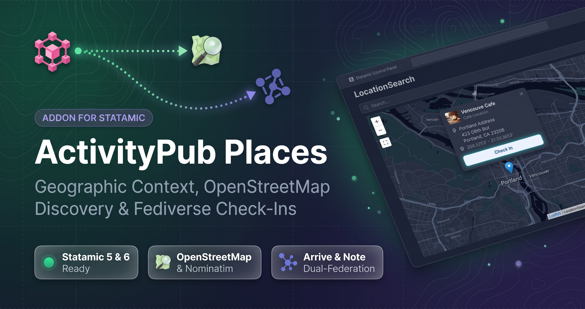
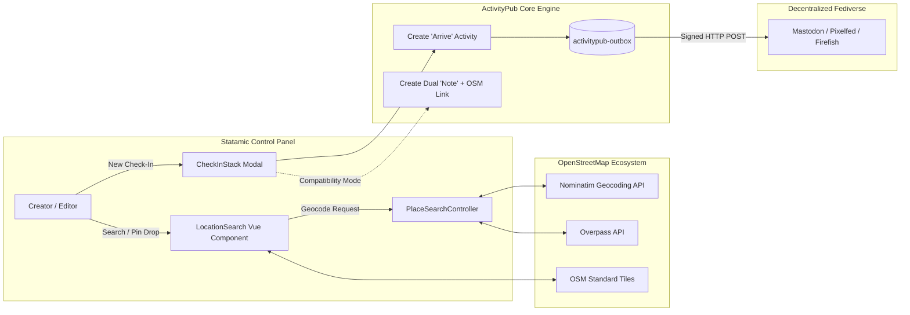
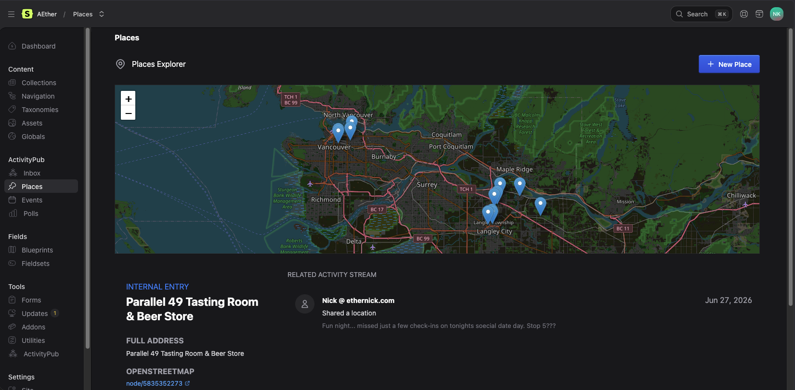
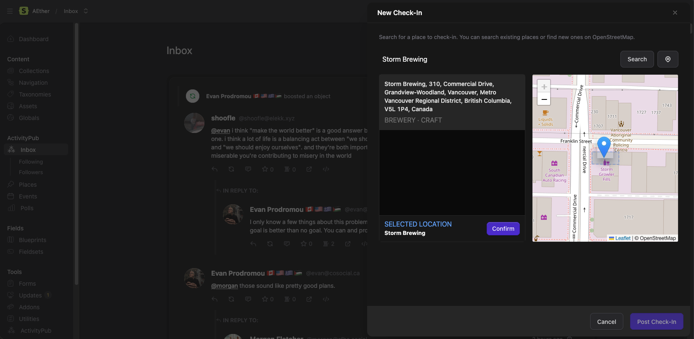
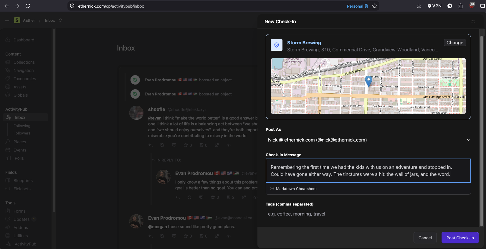
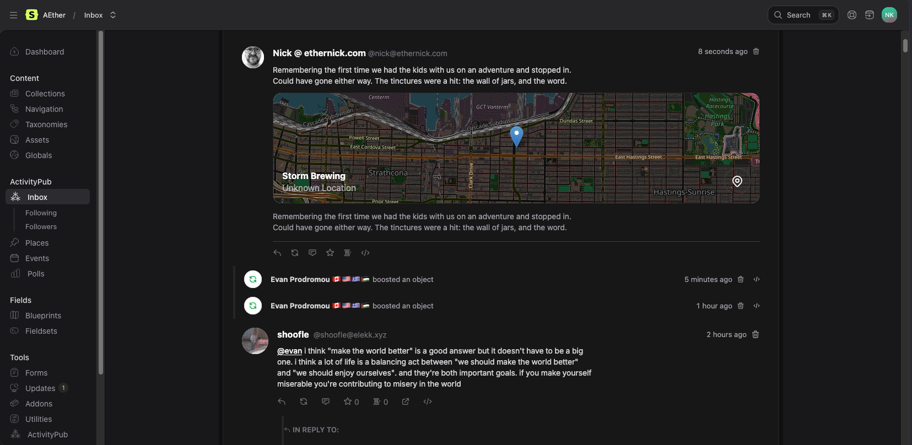

# ActivityPub Places for Statamic

<p align="center">
  
</p>

[](https://statamic.com)
[](CHANGELOG.md)
[](https://php.net)
[](https://www.openstreetmap.org/)
[](https://w3.org/TR/activitypub/)
[](LICENSE.md)

> [!NOTE]  
> **Pre-Release:**  
> ActivityPub Places is an early companion addon for [`statamic-activitypub-core`](https://worktree.ca/ethernick/statamic-activitypub-core). Free for local development and non-production testing under our [Commercial Source-Available License](https://worktree.ca/ethernick/statamic-activitypub-places/src/branch/main/LICENSE.md). Available for feedback ahead of official Marketplace publication.

Add rich geographic context, interactive OpenStreetMap location discovery, and federated `Arrive` check-ins to your Statamic site. **ActivityPub Places** extends [`statamic-activitypub-core`](https://github.com/ethernick/statamic-activitypub-core) to seamlessly publish check-ins and location-tagged posts to Mastodon, Pixelfed, and the broader Fediverse.

---

## ✨ Features at a Glance

| Feature | Description |
|---|---|
| 📍 **Federated Check-Ins (`Arrive`)** | Broadcast native ActivityStreams `Arrive` check-in activities across the Fediverse whenever you publish or check in to a place. |
| 🗺️ **OpenStreetMap & Nominatim Search** | Search global places, venues, cafes, and landmarks directly from the Statamic Control Panel with live polygon and bounding-box previews. |
| 📌 **Interactive Pin Drop & Reverse Geocode** | Click anywhere on the map to drop a pin and instantly reverse-geocode coordinates via Nominatim & Overpass. |
| 📱 **Mastodon Compatibility Mode** | Automatically syndicate an accompanying Mastodon-compatible `Note` with markdown deep links to OpenStreetMap for platforms without native `Arrive` views. |
| 🧭 **Custom Leaflet Antlers Tags** | Render interactive Leaflet maps with pins (`{{ activitypub_place:map }}`) and external map provider links (`{{ activitypub_place:links }}`) on your frontend. |
| 📬 **Interactive Inbox Maps** | View incoming location-tagged posts and check-ins with an interactive Leaflet map rendered directly in the Control Panel Inbox stream. |
| ⚡ **Zero-Bloat Sidecar Storage** | GeoJSON coordinates, OSM nodes/ways/relations, and ActivityPub payloads are stored cleanly alongside flat-file entries. |

---

## 🚀 Quick Start

### 1. Require Package via Composer

Install `activitypub-places` into your Statamic application root:

```bash
composer require ethernick/statamic-activitypub-places
```

### 2. Run the Interactive Guided Installer

Run the one-step guided installer:

```bash
php artisan activitypub:places:install
```

The installer automatically:
- Provisions the **`places`** collection and default `place.yaml` blueprint with OSM identifiers, coordinates, and address fields.
- Configures `/places/{osm_type}/{osm_id}` nested routing.
- Enables Places federation in `settings/activitypub.yaml`.
- Publishes Control Panel Vue 2 (Statamic 5) and Vue 3 (Statamic 6) assets.

### 3. Configure Nominatim User-Agent

Open **Control Panel > ActivityPub > Settings > Places** and provide your application or contact name in the `Nominatim User-Agent` field to comply with OpenStreetMap's API usage policy.

---

## 🏛️ System Architecture



---

## 🏷️ Antlers Frontend Tags

Display locations and maps on your public site using the `{{ activitypub_place }}` Antlers tags:

### Interactive Leaflet Map (`{{ activitypub_place:map }}`)

Renders a mobile-responsive Leaflet map centered on the place's coordinates with a customizable marker:

```antlers
<div class="place-container my-8">
    <h1 class="text-3xl font-bold">{{ title }}</h1>
    <p class="text-gray-600">{{ address }}</p>

    <!-- Renders responsive Leaflet map (default height: 400px) -->
    {{ activitypub_place:map }}
</div>
```

### Map Provider Directions & Links (`{{ activitypub_place:links }}`)

Generates deep links to popular external navigation providers (OpenStreetMap, Google Maps, Apple Maps):

```antlers
<div class="directions-links mt-4">
    <h3 class="font-semibold text-lg">Open in Maps:</h3>
    <ul class="flex gap-4">
        {{ activitypub_place:links }}
            <li>
                <a href="{{ url }}" target="_blank" rel="noopener" class="underline text-blue-600 capitalize">
                    {{ type }}
                </a>
            </li>
        {{ /activitypub_place:links }}
    </ul>
</div>
```

---

## 🖼️ Control Panel Experience

| Places Dashboard & Leaflet Map | OSM Search & Pin Drop Drawer |
| :---: | :---: |
|  |  |

| Federated Check-In Modal | Interactive Inbox Map Feed |
| :---: | :---: |
|  |  |

---

## 📚 Documentation & Guides

- **[Production Operator & Installation Guide](docs/INSTALLATION.md)** — Requirements, automated setup, tile server tuning, and Nominatim compliance.
- **[Troubleshooting & Operations Runbook](docs/TROUBLESHOOTING.md)** — Resolutions for Nominatim 403s, map container zero-height, and check-in delivery.
- **[Places Federation & Architecture Guide](docs/PLACES_GUIDE.md)** — Architectural details on `Arrive` vs `Create`, OSM identifier mapping, and caching.
- **[Extension Developer Guide (HOOKS.md)](docs/HOOKS.md)** — How to extend Places, customize transform hooks, and override Antlers templates.
- **[Marketplace Launch Blueprint](docs/MARKETPLACE_LAUNCH.md)** — Hero banner specs, screenshot briefs, demo video storyboard, and onboarding copy.
- **[Product Requirements Document](docs/PRD.md)** — Discovery history, design decisions, and session changelog.
- **[Task Roadmap & Release Checklist](docs/TASKS.md)** — Punch-list and milestones.

---

## 🤝 Community & Support

- **Bug Reports & Issues**: [GitHub Issues](https://github.com/ethernick/statamic-activitypub-places/issues)
- **Source Code**: [GitHub Repository](https://github.com/ethernick/statamic-activitypub-places)
- **ActivityPub Core**: [Core Addon Repository](https://github.com/ethernick/statamic-activitypub-core)

---

## 📄 License

ActivityPub Places for Statamic is source-available software provided under the **[Statamic Commercial License](LICENSE.md)** (free for local development and non-production testing; requires a valid commercial license for live production deployments).

## 🦾 AI Disclosure

Written with the assistance of AI agents including Gemini & Claude.
 