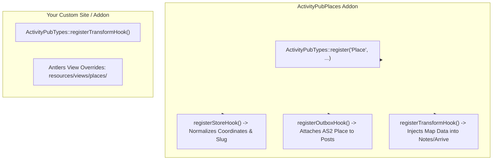

# ActivityPub Places Developer & Extension Guide

A technical reference guide for developers looking to extend **ActivityPub Places**, hook into location transformations, customize map components, or build custom frontends.

---

## 🏗️ Architecture & Extension Points

ActivityPub Places registers the `Place` type into `ActivityPubCore` and hooks into both the storage and transformation lifecycles:



---

## 1. Transforming Outgoing Payloads

If your application attaches custom venue metadata (such as WiFi quality, opening hours, or accessibility tags), you can hook into `ActivityPubTypes::registerOutboxHook`:

```php
use Ethernick\ActivityPubCore\Services\ActivityPubTypes;

ActivityPubTypes::registerOutboxHook(function ($entry, array &$data) {
    if ($entry->collection()->handle() !== 'places') {
        return;
    }

    // Attach custom schema or FEP extension properties
    if ($entry->get('wheelchair_accessible')) {
        $data['amenityFeature'] = [
            'type' => 'LocationFeatureSpecification',
            'name' => 'Wheelchair Accessible',
            'value' => true,
        ];
    }
}, priority: 20);
```

---

## 2. Ingesting Inbound Location Data

When external Fediverse instances send check-ins or location-aware notes, ActivityPub Places automatically transforms them for display in the CP Inbox feed:

```php
ActivityPubTypes::registerTransformHook(function ($entry, array &$data) {
    if ($entry->collection()->handle() !== 'notes') {
        return;
    }

    $payload = \Ethernick\ActivityPubCore\Storage\ActivityPubPayload::for($entry)->toArray();
    $lat = $payload['location']['latitude'] ?? null;
    $lon = $payload['location']['longitude'] ?? null;

    if ($lat && $lon) {
        $data['location'] = [
            'latitude' => (float) $lat,
            'longitude' => (float) $lon,
            'name' => $payload['location']['name'] ?? null,
        ];
    }
});
```

---

## 3. Customizing Frontend Leaflet Maps

The `{{ activitypub_place:map }}` tag outputs an HTML container with pre-bundled Leaflet assets.

### Custom Styling
To change map height or dimensions, wrap the tag in a styled wrapper:

```html
<div class="h-96 w-full rounded-2xl overflow-hidden shadow-2xl border">
    {{ activitypub_place:map }}
</div>
```

### Passing Specific Place Context
If rendering a map outside a single entry context (e.g. inside an author's list of favorite places):

```antlers
{{ collection:places }}
    <div class="card mb-8">
        <h2>{{ title }}</h2>
        {{ activitypub_place:map :id="id" }}
    </div>
{{ /collection:places }}
```

---

## 4. Control Panel Components & Multi-Phase Stacks

ActivityPub Places ships Control Panel views and Vue stacks:
- **`places-dashboard`**: Full-width map and saved venues list.
- **`LocationSearch`**: Nominatim search box with interactive map preview and mobile viewport segmentation.
- **`CheckInStack`**: Drawer modal for publishing check-ins.
- **`PlaceStack`**: Drawer modal for registering saved places.

### Using `<location-search>` in Custom Addons & Stacks

When embedding `<location-search>` in custom stacks or modal dialogs (like `EventStack` or `CheckInStack`), adhere to the multi-phase selection pattern:

```html
<location-search 
    @change="provisionalLocation = $event" 
    @selected="confirmLocation" 
/>
```

#### Events Emitted by `LocationSearch`

| Event | Payload | Description |
|---|---|---|
| `@change` | `LocationObject \| null` | Fires immediately when a user clicks a search result or places a pin on the map. Use this in multi-phase drawers to enable a sticky **Confirm Location** button in your footer without prematurely locking the form. |
| `@selected` | `LocationObject` | Fires when the user confirms their selection inside the search card or when programmatically confirmed. |

#### Sticky Footer Pattern (Multi-Phase Drawers)

To ensure smooth mobile UX where Leaflet map interactions do not trap scrolling or obscure primary actions:

1. **Phase 1 (Search / Selection):** 
   - Render the search card and track `provisionalLocation = $event` via `@change`.
   - In the drawer footer, render a **Confirm Location** button (`:disabled="!provisionalLocation"`).
   - Upon clicking **Confirm Location**, commit `selected = provisionalLocation`, transitioning the stack to Phase 2.
2. **Phase 2 (Form Completion):**
   - Display a compact location summary badge with a **Change Location** link (which sets `selected = null` to return to Phase 1).
   - The drawer footer transforms the primary button into the final submission action (e.g., **Post Check-In**, **Save Place**, **Post Event**).

