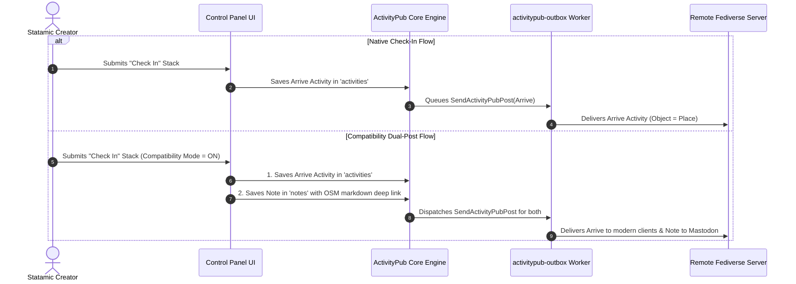

# Places Federation & Architecture Guide

An architectural deep dive into how **ActivityPub Places** manages spatial data, interacts with the OpenStreetMap ecosystem, serializes W3C ActivityStreams objects, and integrates with the Fediverse.

---

## 🌍 Spatial Data & OpenStreetMap Identity

In traditional CMS workflows, location tagging is often restricted to simple strings (e.g. "Seattle, WA"). ActivityPub Places treats locations as **first-class geographic objects** connected to the decentralized OpenStreetMap knowledge graph.

### 1. The Dual-Name Architecture

Places decouple internal editorial titles from public geographic venue names:
- **`osm_name`**: The canonical name as recognized by OpenStreetMap (e.g., *"Stumptown Coffee Roasters"*). This serves as the public `name` in outbound ActivityPub JSON.
- **`title`**: The editorial title assigned by the Statamic author (e.g., *"My Favorite Morning Work Spot"*). This is serialized as the `summary` or note text.
- **Address & Geometry**: Complete structured address breakdown, latitude, longitude, and optional GeoJSON polygon boundaries.

### 2. OSM Identifiers & Canonical Slugs

Places entries use OpenStreetMap's tripartite node/way/relation typology to form collision-free canonical URLs:

| OSM Element | Typology | Canonical Statamic Route | External Reference Link |
| :--- | :--- | :--- | :--- |
| **Node** | Point of Interest / Pin | `/places/node/{id}` | `https://www.openstreetmap.org/node/{id}` |
| **Way** | Building / Street / Polygon | `/places/way/{id}` | `https://www.openstreetmap.org/way/{id}` |
| **Relation** | Compound area / Campus | `/places/relation/{id}` | `https://www.openstreetmap.org/relation/{id}` |

---

## 📬 ActivityPub Activity Topology: `Arrive` vs `Create`

In ActivityStreams 2.0 (AS2), location-aware interactions are represented using two distinct models:



### 1. The `Arrive` Activity
When an author performs a check-in, an Activity of type `Arrive` is generated:
```json
{
  "@context": "https://www.w3.org/ns/activitystreams",
  "id": "https://example.com/activities/01j...arrive",
  "type": "Arrive",
  "actor": "https://example.com/@editor",
  "summary": "Having an iced latte before writing the newsletter!",
  "object": {
    "type": "Place",
    "id": "https://example.com/places/node/12345678",
    "name": "Stumptown Coffee Roasters",
    "latitude": 45.518,
    "longitude": -122.653
  },
  "published": "2026-09-21T16:00:00Z",
  "to": ["https://www.w3.org/ns/activitystreams#Public"]
}
```

### 2. Location-Enriched Content Entries (Notes & Articles)
When saving regular blog posts or articles that reference a place, the place is appended to the standard `Create(Note)` activity via the AS2 `location` property:
```json
{
  "type": "Note",
  "id": "https://example.com/notes/my-coffee-review",
  "content": "<p>A fantastic space to read and reflect.</p>",
  "location": {
    "type": "Place",
    "name": "Stumptown Coffee Roasters",
    "latitude": 45.518,
    "longitude": -122.653
  }
}
```

---

## ⚡ Performance, Caching & Rate Limits

OpenStreetMap's public servers are community-operated and subject to strict usage limits:
- **Nominatim Limit:** Maximum 1 request per second; absolute requirement for custom User-Agent.
- **Local Cache First:** `PlaceSearchController` always searches local `places` collection entries first before executing remote Nominatim queries. If an exact internal match is found, remote timeouts are tightened to 3 seconds.
- **Overpass Radius Caching:** Overpass geometric boundaries are queried only during discovery and pinned directly into the place entry's front matter, avoiding repeat external API hits.
